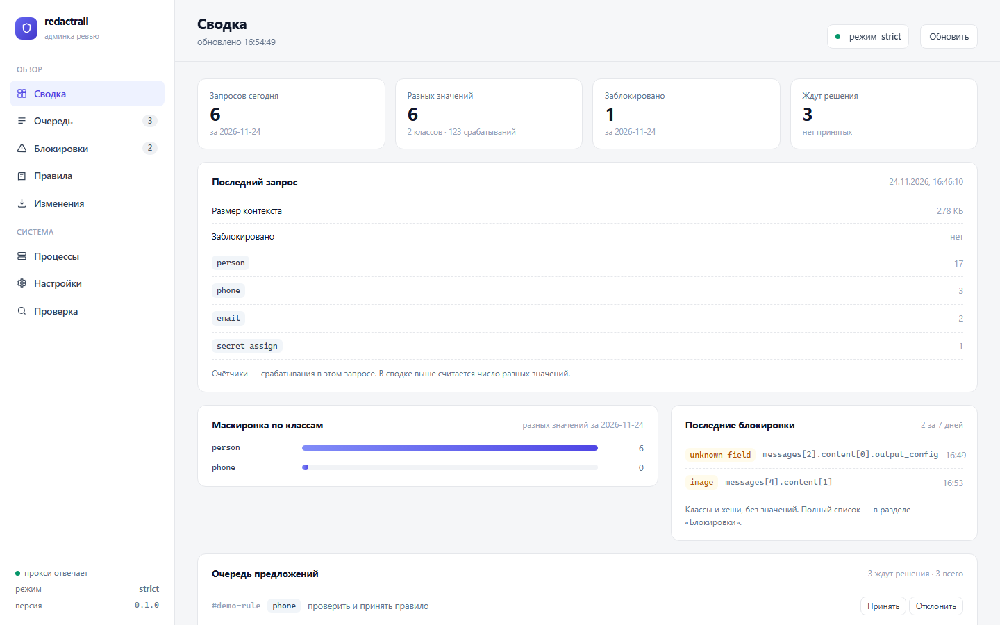
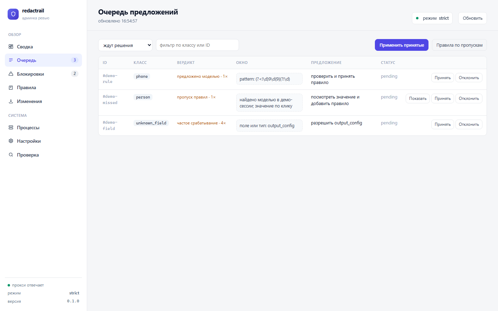
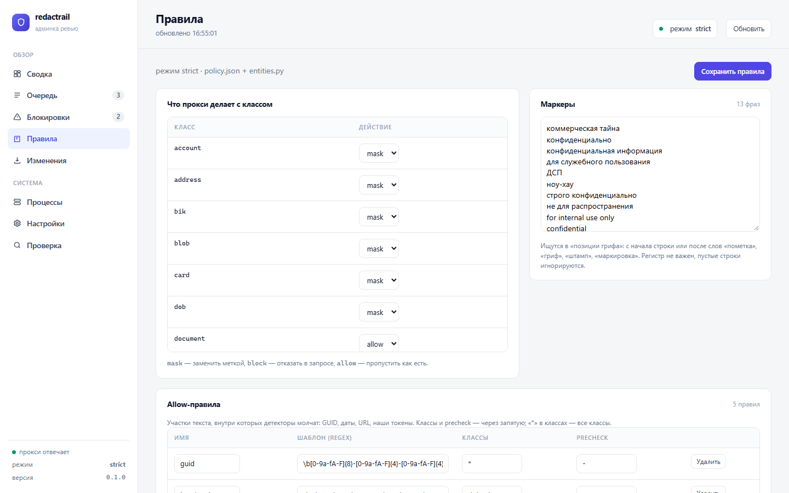

# redactrail

Русский(README.md) · [English](README.en.md)

[](https://github.com/dmtr-io/redactrail/actions/workflows/ci.yml)
[](LICENSE)
[](pyproject.toml)

A local privacy proxy between **DeepSeek Harness** and the provider. It masks
personal data, bank details and secrets in outbound requests and blocks request
shapes it cannot parse. Standard library only.

> **Status: 0.1.0, beta.** Scope: DeepSeek Harness only, Windows-first.
> This is not a DLP product and not a compliance guarantee.

## Installation (Windows)

Download the installer from the latest release and run it:

```powershell
irm https://github.com/dmtr-io/redactrail/releases/latest/download/install.ps1 -OutFile install.ps1
powershell -ExecutionPolicy Bypass -File .\install.ps1
```

The installer needs no administrator rights. It:

- installs Python 3.12+ when missing (winget or the official python.org installer);
- unpacks the release into `%LOCALAPPDATA%\redactrail`;
- creates `policy.json` from the example (never overwrites an existing one);
- starts the proxy and admin UI and checks `/health`;
- opens the admin UI and prints the address to put into DSH.

Flags: `-Autostart`, `-Port 8787`, `-NoStart`, `-NoPython`,
`-SourcePath <zip>` (install from a local archive).

Uninstall with `uninstall.ps1` from the install directory; by default it
keeps `policy.json`, `state/` and `audit/`; `-Purge` removes everything.

## Scope

| | |
|---|---|
| Client | DeepSeek Harness (DSH), Anthropic Messages wire format |
| OS | Windows 10/11 |
| Python | 3.12+ (zstd session audit needs 3.14 or `zstd` in `PATH`) |
| Other clients | untested; the wire format is compatible, behavior is not guaranteed |

## What it does

- masks names, phones, emails, INN/OGRN/SNILS, cards, passports, dates of
  birth, addresses, logins and organizations;
- masks secrets (keys, tokens, passwords, PEM) and **never restores them**;
- blocks unknown fields, block types, images, documents and oversized requests
  (fail closed);
- restores pseudonyms in responses: text, `thinking` and `tool_use`;
- caches detection results per text hash and policy fingerprint;
- normalizes zero-width, bidi and full-width characters before detection;
- ships an admin UI and a local-model audit that suggests rules for missed PII;
  a human approves every change.

## Quick start

```powershell
copy policy.example.json policy.json
python -m redactrail.app
```

Check `http://127.0.0.1:8787/health`; then point DSH at the proxy:

```yaml
- id: llm-deepseek-account
  name: '@deepseek-ai/dsh-llm-deepseek-account'
  config:
    baseURL: http://127.0.0.1:8787/anthropic
```

Restart DSH. Rollback: restore `baseURL` and restart. The admin UI is at
`http://127.0.0.1:8788/` and is opened manually.

Autostart without console windows (Windows):

```powershell
powershell -ExecutionPolicy Bypass -File scripts\install-autostart.ps1 -NoAudit
```

## Configuration

Everything lives in `policy.json` (see [policy.example.json](policy.example.json)):
`mode`, per-class `actions`, `markers`, `allow`, `restore`, `request` fields,
`limits`, `review` and `extra_rules`. The model endpoint is a setting
(**Processes → Model endpoint** or `REDACTRAIL_REVIEW_URL`), localhost by
default.

## Screenshots

Synthetic demo data only:





## Benchmark

199 synthetic documents / 421 entities:

```
python scripts/bench_detectors.py --corpus tests/corpus/pii_bench.jsonl --gate
```

Current result: recall 1.00 (overlap), precision 1.00, FP 0, p95 < 1 ms.
This measures the rules on a synthetic corpus, **not** production validation.
Method and limitations: [docs/benchmark.md](docs/benchmark.md) (Russian).

## Limitations

- Heuristics: unusual name forms, rare addresses and transliteration can pass.
- Audit is advice, not a guarantee; the local model can be wrong.
- Secrets are never restored, but they may already be in DSH history from
  before the proxy was enabled.
- Windows-only: Linux/macOS are untested.
- **Provided AS IS**, without warranties; use at your own risk. The author does
  not guarantee PII protection and is not liable to the extent permitted by law.

## Security

Proxy and admin listen on loopback only; the admin UI is not designed for a
network. Report issues privately per [SECURITY.md](SECURITY.md); threat model in
[docs/threat-model.md](docs/threat-model.md) (Russian).

## Documentation

Detailed documentation is currently in Russian:
[docs/admin-ui.md](docs/admin-ui.md) · [docs/audit.md](docs/audit.md) ·
[docs/benchmark.md](docs/benchmark.md) · [docs/rules.md](docs/rules.md) ·
[docs/storage.md](docs/storage.md) · [docs/threat-model.md](docs/threat-model.md).

## Contributing and license

[CONTRIBUTING.en.md](CONTRIBUTING.en.md) · [CODE_OF_CONDUCT.md](CODE_OF_CONDUCT.md) ·
[MIT](LICENSE).
