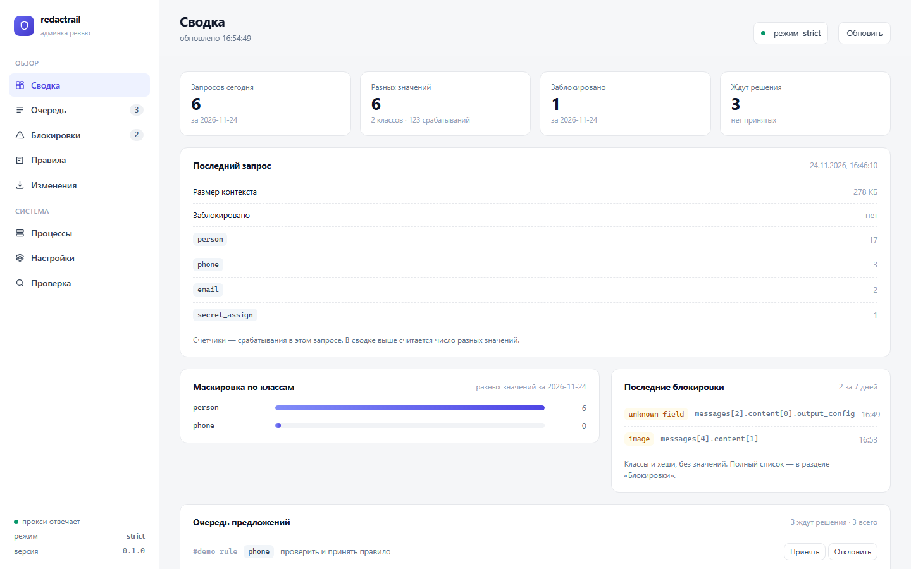
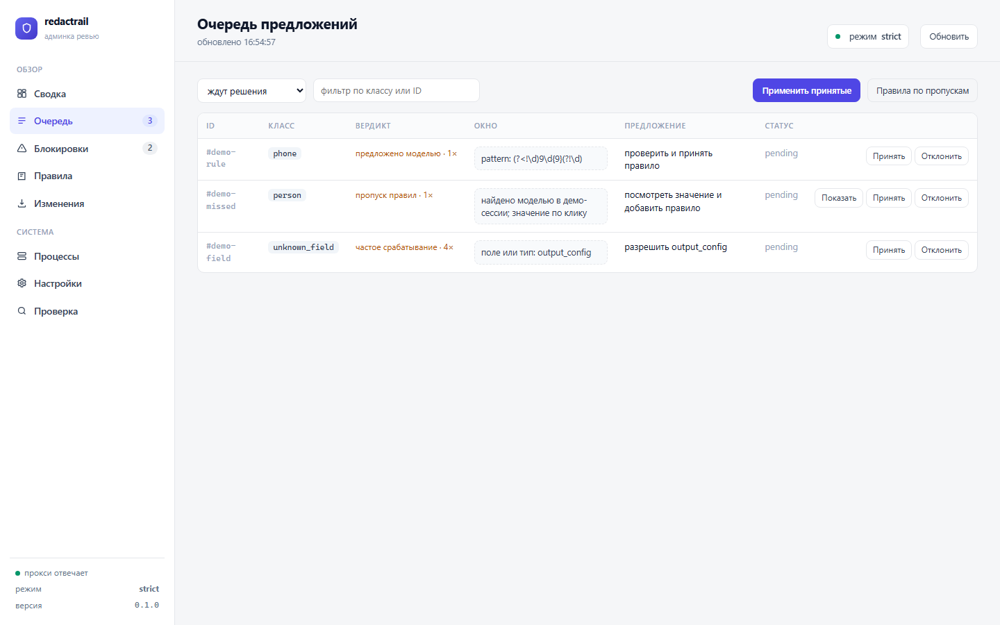
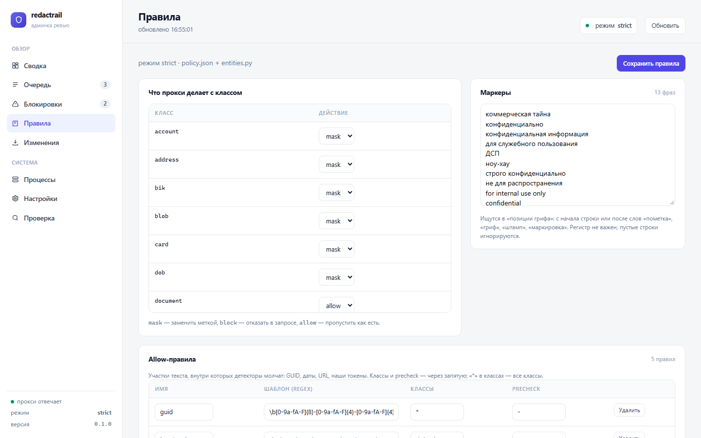

# redactrail

Русский · [English](README.en.md)

[](https://github.com/dmtr-io/redactrail/actions/workflows/ci.yml)
[](LICENSE)
[](pyproject.toml)

Локальный прокси между **DeepSeek Harness** и провайдером: маскирует
персональные данные, реквизиты и секреты в запросах, а неразбираемые
структуры блокирует. Работает без внешних зависимостей, только стандартная
библиотека Python.

> **Статус: 0.1.0, beta.** Область — только DeepSeek Harness. Windows-first.
> Это не DLP и не юридическая гарантия: эвристики, локальные словари и правила.

## Область применения

| | |
|---|---|
| Клиент | DeepSeek Harness (DSH), протокол Anthropic Messages |
| ОС | Windows 10/11 |
| Python | 3.12+ (аудит с zstd-сессиями — 3.14 или `zstd` в `PATH`) |
| Другие клиенты | не тестировались; протокол совместим, но поведение не гарантируется |

Прокси проверен на DSH 0.2.x. Другие версии могут присылать новые поля — они
разрешаются в `policy.json` без правки кода; неизвестная структура по умолчанию
блокируется.

## Что делает

- **Маскирование ПДн**: ФИО, телефоны, почта, ИНН, ОГРН, СНИЛС, карты,
  паспорт, даты рождения, адреса, логины, организации.
- **Секреты**: ключи, токены, пароли и PEM; они маскируются и **никогда не
  разворачиваются** обратно.
- **Блокировка структуры**: неизвестные поля, блоки, документы, изображения,
  слишком большие запросы — отказ, а не «пропустить на всякий случай».
- **Разворот псевдонимов** в ответе: текст (включая `thinking`) и `tool_use`.
- **Кеш детекции**: повторная история не сканируется заново.
- **Нормализация**: zero-width, bidi и полноширинные глифы не обходят правила.
- **Админка и аудит**: очередь предложений, правила, журналы; локальная модель
  ищет пропуски и предлагает регулярки, решение принимает человек.

## Как это работает

```
DSH ──► 127.0.0.1:8787 ──► api.deepseek.com
         │
         ├── sanitizer: маскирование / блокировка
         ├── audit/YYYY-MM-DD.jsonl: классы, хеши, счётчики
         └── 127.0.0.1:8788: админка (только loopback)
```

Значения не пишутся на диск. Таблица «токен → значение» живёт один запрос.
Ответ провайдера разворачивается той же таблицей; если токен пришёл из старого
запроса, он останется токеном.

## Быстрый старт

```powershell
# 1. Python 3.12+ и исходники
copy policy.example.json policy.json

# 2. Прокси и админка одним процессом
python -m redactrail.app
```

Проверка: `http://127.0.0.1:8787/health` → `{"status": "ok", "mode": "strict"}`.

Подключение DSH: в профиле (`profiles/desktop/cordis.patch.yml`) у
`llm-deepseek-account` задать:

```yaml
- id: llm-deepseek-account
  name: '@deepseek-ai/dsh-llm-deepseek-account'
  config:
    baseURL: http://127.0.0.1:8787/anthropic
```

Затем перезапустить DSH. Откат — вернуть `baseURL` и перезапустить.

Постоянная работа: задача планировщика через `pythonw.exe`, без консоли и без
браузера:

```powershell
powershell -ExecutionPolicy Bypass -File scripts\install-autostart.ps1 -NoAudit
```

Админка открывается вручную: **http://127.0.0.1:8788/**.

## Конфигурация

Всё в `policy.json` (пример — [policy.example.json](policy.example.json)):

| Раздел | Что задаёт |
|---|---|
| `mode` | `strict`, `audit`, `off` |
| `actions` | `mask` / `block` / `allow` для класса |
| `markers` | фразы-маркеры конфиденциальности |
| `allow` | GUID, URL, ISO-даты, свои токены |
| `restore` | разворачивать текст и `tool_use` |
| `request` | разрешённые поля, роли и типы блоков |
| `limits` | куски текста, размер запроса, бюджет, retention |
| `review` | адрес и модель локального аудита |
| `extra_rules` | дополнительные регулярки, принятые человеком |

Адрес модели аудита задаётся в **Процессы → Адрес модели** или через
`REDACTRAIL_REVIEW_URL`; в публичном примере — localhost.

## Скриншоты

Демонстрационные данные, без реальных ПДн:





## Бенчмарк

Синтетический корпус: 199 документов, 421 сущность.

```
python scripts/bench_detectors.py --corpus tests/corpus/pii_bench.jsonl --gate
```

Текущий результат: recall 1.00 (overlap), precision 1.00, FP 0 на ~14 тыс.
символов, p95 < 1 мс. Это проверка правил на синтетике, **не** валидация на
реальных данных. Методика, корпус и ограничения — [docs/benchmark.md](docs/benchmark.md).

## Ограничения

- Эвристики: незнакомые формы имён, редкие адреса и транслит могут пропускаться.
- Аудит — советы, а не гарантия; модель может ошибаться.
- Секреты не разворачиваются, но могут остаться в истории DSH, если попали туда
  до включения прокси.
- Windows-only: Linux/macOS не тестировались.
- **Поставляется «как есть»**, без гарантий; используете на свой страх и риск.
  Автор не гарантирует защиту персональных данных и не несёт ответственности
  в пределах, допускаемых применимым правом.

## Безопасность

Прокси и админка слушают только `127.0.0.1`. Админка не предназначена для
сети. О проблемах — приватно, по [SECURITY.md](SECURITY.md); модель угроз —
[docs/threat-model.md](docs/threat-model.md).

## Документация

[docs/admin-ui.md](docs/admin-ui.md) · [docs/audit.md](docs/audit.md) ·
[docs/benchmark.md](docs/benchmark.md) · [docs/rules.md](docs/rules.md) ·
[docs/storage.md](docs/storage.md) · [docs/threat-model.md](docs/threat-model.md)

## Вклад

См. [CONTRIBUTING.md](CONTRIBUTING.md) и [CODE_OF_CONDUCT.md](CODE_OF_CONDUCT.md).
Тесты и бенчмарк: `scripts/test.ps1`. В фикстурах — только синтетические данные.

## Лицензия

[MIT](LICENSE).
